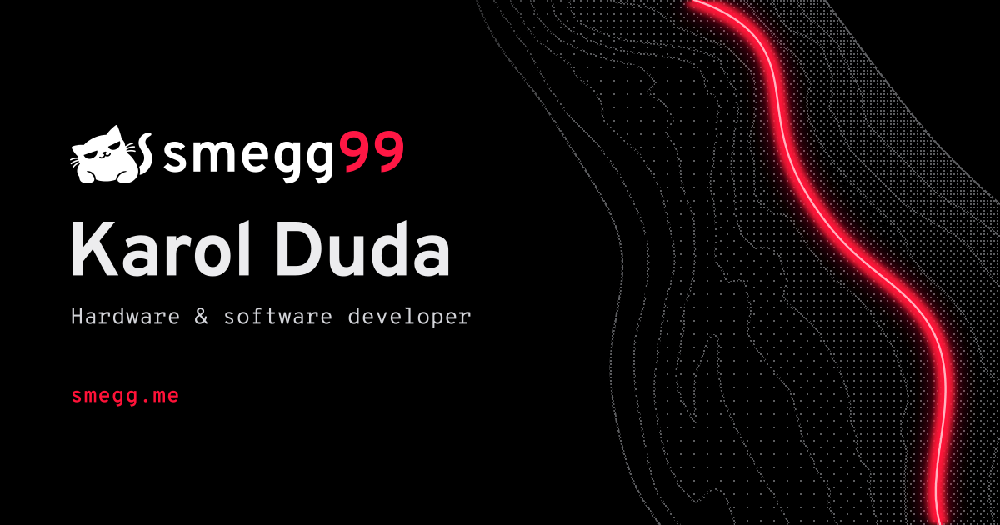
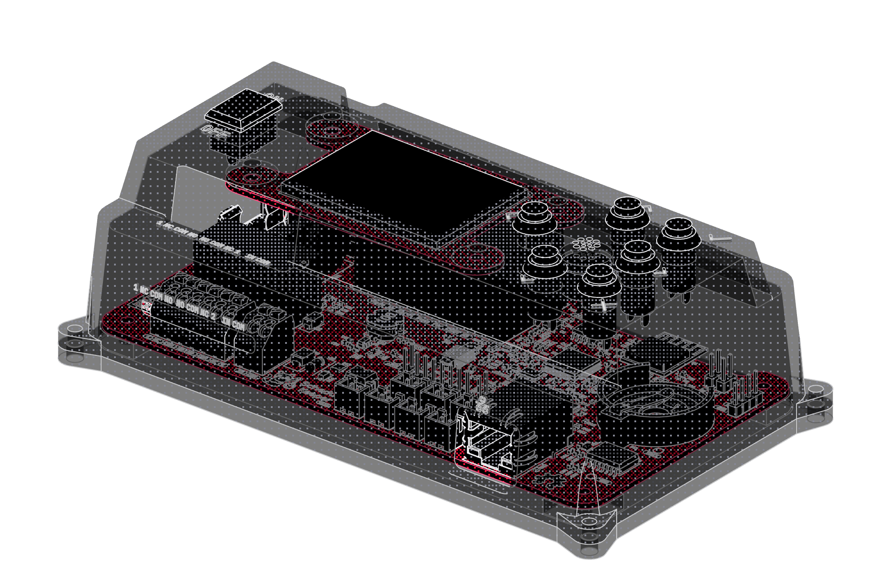
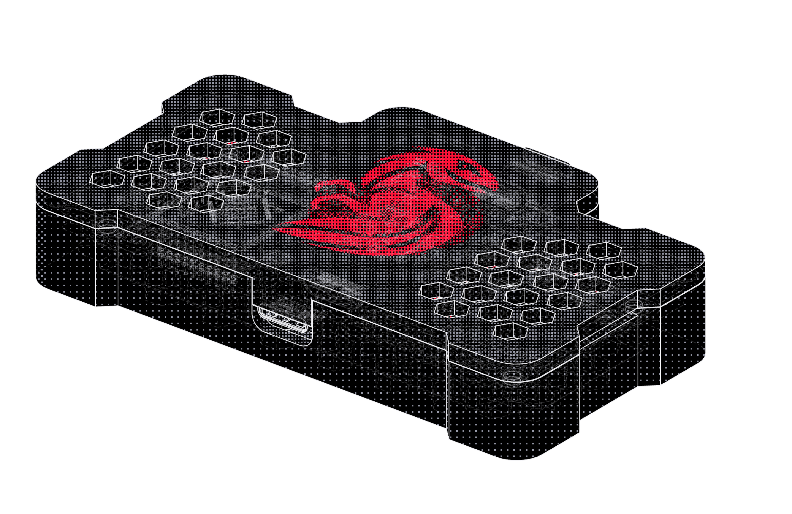
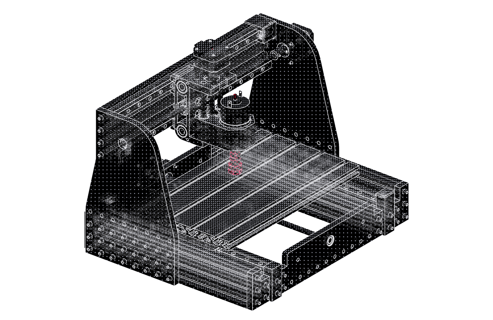

**Boards, firmware and apps. Usually all three for the same thing.**

I'm Karol, a mechatronics student from Nowy Sącz, Poland. I write Go, design PCBs, and build hardware.

[Website](https://smegg.me) / [Contact](https://smegg.me/contact) / [LinkedIn](https://www.linkedin.com/in/duda-karol)

## Hardware

<h3><a href="https://github.com/smegg99/ScheduleKeeper">
  <picture>
    <source media="(prefers-color-scheme: dark)" srcset="./assets/logos/schedulekeeper.svg" />
    
  </picture>
</a></h3>

The bell controller I built for my old school. Running at ZSEM since late 2022, with new hardware and firmware in progress.

STM32 / Zephyr / C / KiCad / Inventor

[Source](https://github.com/smegg99/ScheduleKeeper) / [Explore the model](https://smegg.me/projects/schedulekeeper)

 

<h3><a href="https://github.com/smegg99/LoRaptor">
  <picture>
    <source media="(prefers-color-scheme: dark)" srcset="./assets/logos/loraptor.svg" />
    
  </picture>
</a></h3>

A LoRa messenger we built as a team of three: the board, firmware, and chat app. No internet needed. Paused for now.

ESP32-S3 / C++ / LoRa / KiCad / Flutter

[Source](https://github.com/smegg99/LoRaptor) / [Explore the model](https://smegg.me/projects/loraptor)

 

<h3><a href="https://github.com/smegg99/SmeggCNC">
  <picture>
    <source media="(prefers-color-scheme: dark)" srcset="./assets/logos/smeggcnc.svg" />
    
  </picture>
</a></h3>

My 3018 Pro CNC, rebuilt in steel and aluminium.

Inventor / CNC

[Source](https://github.com/smegg99/SmeggCNC) / [Explore the model](https://smegg.me/projects/cnc)

 

## Software

<h3><a href="https://github.com/smegg99/SmeggTuner">
  <picture>
    <source media="(prefers-color-scheme: dark)" srcset="./assets/logos/smeggtuner.svg" />
    
  </picture>
</a></h3>

A free accordion tuner. Measures reeds and the beats between them, from a microphone or a WAV file. [Try it or download it.](https://smeggtuner.com)

<h3><a href="https://github.com/smegg99/Goptivum">
  <picture>
    <source media="(prefers-color-scheme: dark)" srcset="./assets/logos/goptivum.svg" />
    
  </picture>
</a></h3>

I started Goptivum to replace Optivum at my school. It runs the bells at ZSEM; I'm still building my own timetable solver.

<h3><a href="https://qr2g.it">
  <picture>
    <source media="(prefers-color-scheme: dark)" srcset="./assets/logos/qr2g.it.svg" />
    
  </picture>
</a></h3>

Short links and QR codes for GitHub repos. Rename or transfer the repo; the link still works. [Source.](https://github.com/smegg99/qr2g.it)

<h3><a href="https://github.com/smegg99/plasma-deep-dim">
  <picture>
    <source media="(prefers-color-scheme: dark)" srcset="./assets/logos/deepdim.svg" />
    
  </picture>
</a></h3>

For monitors that are still too bright at 0%. Per-monitor dimming on KDE Plasma / Wayland.

<h3><a href="https://github.com/smegg99/ThugHunter">
  <picture>
    <source media="(prefers-color-scheme: dark)" srcset="./assets/logos/thughunter.svg" />
    
  </picture>
</a></h3>

Finds publicly accessible VNC services, checks which still answer, and lets me browse the results.

Also: [S99Deploy](https://github.com/smegg99/S99Deploy), the tool I use to deploy my apps.

## What I use

**Know it well:** Go, Autodesk Inventor.

<strong>Getting there:</strong>
Python, TypeScript, Vue, Nuxt, Vuetify, Wails, Linux;
ESP32, Raspberry Pi, Arduino, Home Assistant, ESPHome, KiCad.

**Still learning:** C, C++, Zephyr, STM32, PostgreSQL, SQLite, Docker.

---

More projects, work, and things I've built on [smegg.me](https://smegg.me).
