<a href="https://smegg.me">
  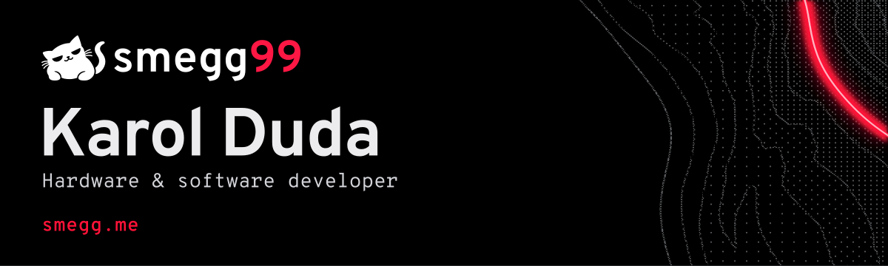
</a>

**Boards, firmware and apps. Usually all three for the same thing.**

I'm Karol. I write Go, design boards, and build things that need both. School bells, an accordion tuner, a LoRa messenger, a rebuilt CNC. Mechatronics student at ANS in Nowy Sącz, Poland.

[**smegg.me**](https://smegg.me) &nbsp; / &nbsp; [write or call](https://smegg.me/contact)

## Things I make

<table>
  <tr>
    <td width="50%" valign="top">
      <a href="https://github.com/smegg99/ScheduleKeeper">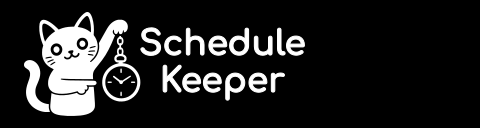</a>
      <a href="https://github.com/smegg99/ScheduleKeeper">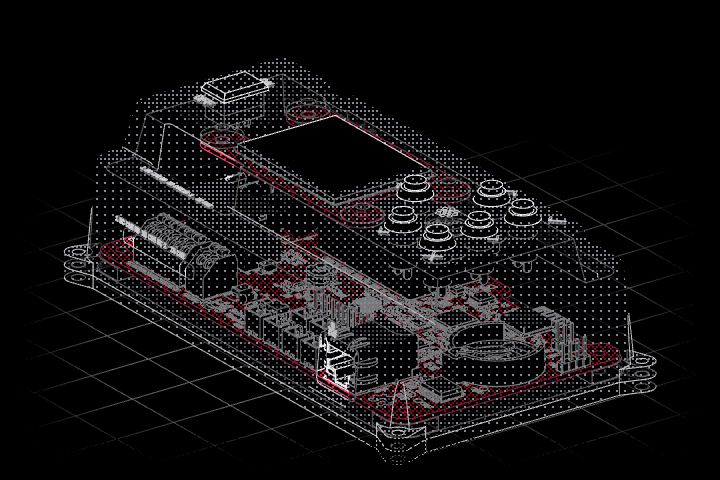</a>
      
My old school's bell controller. I designed the board and wrote the firmware. Ringing at ZSEM since late 2022; I'm working on the next revision.

      
Zephyr / C / STM32 / LVGL / KiCad / Inventor

    </td>
    <td width="50%" valign="top">
      <a href="https://github.com/smegg99/Goptivum">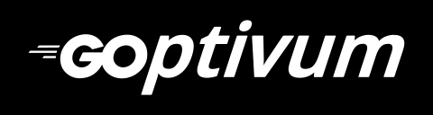</a>
      <a href="https://github.com/smegg99/Goptivum">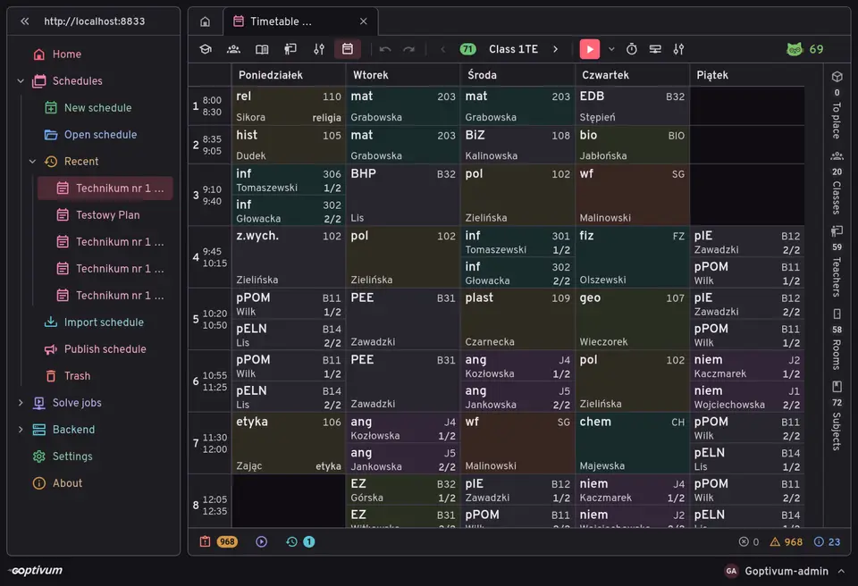</a>
      
My school used Optivum, so I started writing an open replacement. It runs the bells at ZSEM. My own timetable solver is still in the works.

      
Go / Wails v3 / Nuxt 4 / SQLite / Ory Kratos

    </td>
  </tr>
  <tr>
    <td width="50%" valign="top">
      <a href="https://github.com/smegg99/SmeggTuner">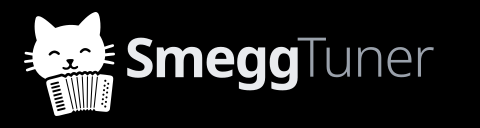</a>
      <a href="https://github.com/smegg99/SmeggTuner">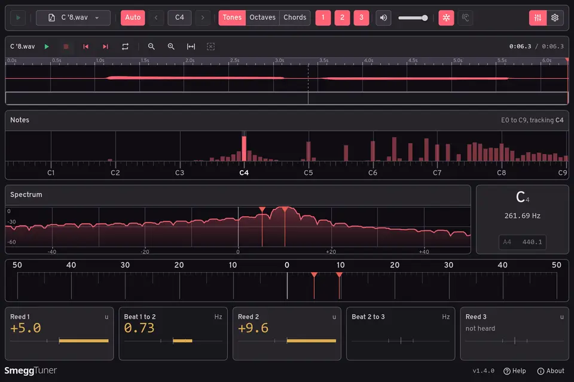</a>
      
Accordion tuners cost hundreds of euros. I wrote a free one. Reeds and beats, from a microphone or a WAV file. Still in beta.

      
Go / Wails v3 / Nuxt 4 <a href="https://smeggtuner.com">Downloads and browser version</a>

    </td>
    <td width="50%" valign="top">
      <a href="https://github.com/smegg99/LoRaptor">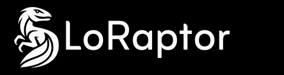</a>
      <a href="https://github.com/smegg99/LoRaptor">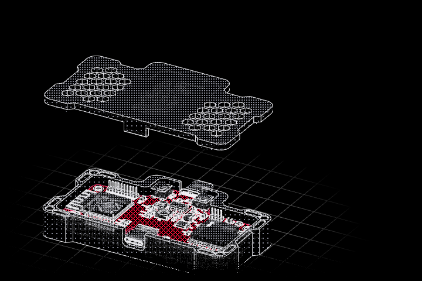</a>
      
Three of us built a LoRa messenger: the device, firmware and chat app. No internet needed. We took it to science fairs; it's paused for now.

      
ESP32-S3 / C++ / LoRa / KiCad / Flutter

    </td>
  </tr>
</table>

  <a href="https://github.com/smegg99/SmeggCNC">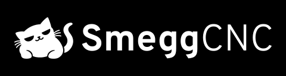</a>
  <a href="https://qr2g.it">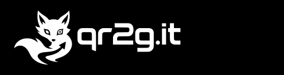</a>
  <a href="https://github.com/smegg99/plasma-deep-dim">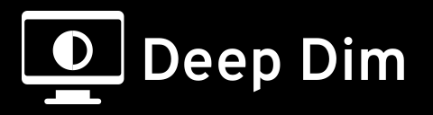</a>
  

- [**SmeggCNC**](https://github.com/smegg99/SmeggCNC): my 3018 Pro CNC, rebuilt in steel and aluminium.
- [**qr2g.it**](https://qr2g.it): short links and QR codes for GitHub repos that survive renames and transfers. [Source](https://github.com/smegg99/qr2g.it).
- [**S99Deploy**](https://github.com/smegg99/S99Deploy): one `deploy.json` per app, one `depl` binary per server.
- [**Deep Dim**](https://github.com/smegg99/plasma-deep-dim): my monitors were too bright at 0%. This dims them further on KDE Plasma / Wayland.
- [**ThugHunter**](https://github.com/smegg99/ThugHunter): finds VNC desktops left open on the internet and checks which still answer.

## What I use

**Know it well:** Go, Autodesk Inventor.

**Getting there:**  Python, TypeScript, Vue, Nuxt, Vuetify, Wails v3, Linux; ESP32, Raspberry Pi, Arduino, Home Assistant, ESPHome, KiCad.

**Still learning:** PostgreSQL, SQLite, Docker; C, C++, Zephyr, STM32.

<strong>Work for other people</strong>

- **Blachotrapez Romania:** a loyalty program, from the Go API and sign-in to the storefront and dashboard.
- **Pressco:** helping manage an online coffee shop, including its Go / Nuxt software.
- **Adis Dom Weselny:** a wedding venue website in four languages, with an enquiry form.
- **Mendi:** Roblox games, from UI to monetisation. Led a team of three and a community of 5,000+ players.

[Screenshots, project details and work history](https://smegg.me/#work)

[LinkedIn](https://www.linkedin.com/in/duda-karol) / CV: [EN](https://smegg.me/media/cv/cv-en.pdf) / [PL](https://smegg.me/media/cv/cv-pl.pdf)

<strong>A few competitions along the way</strong>

- **2025 / 1st place:** Piknik Naukowy ZSEM, Nowy Sącz.
- **2025 / 2nd place:** XIV Małopolski Konkurs Własnych Prac Technicznych.
- **2024 / 1st place:** XIII Małopolski Konkurs Własnych Prac Technicznych.
- **2024 / 2nd place:** Piknik Naukowy ZSEM, Nowy Sącz.
- **2024 / Finalist:** HackYeah.
- **2023 / Finalist:** Olimpiada Innowacji Technicznych PZSWiR.

